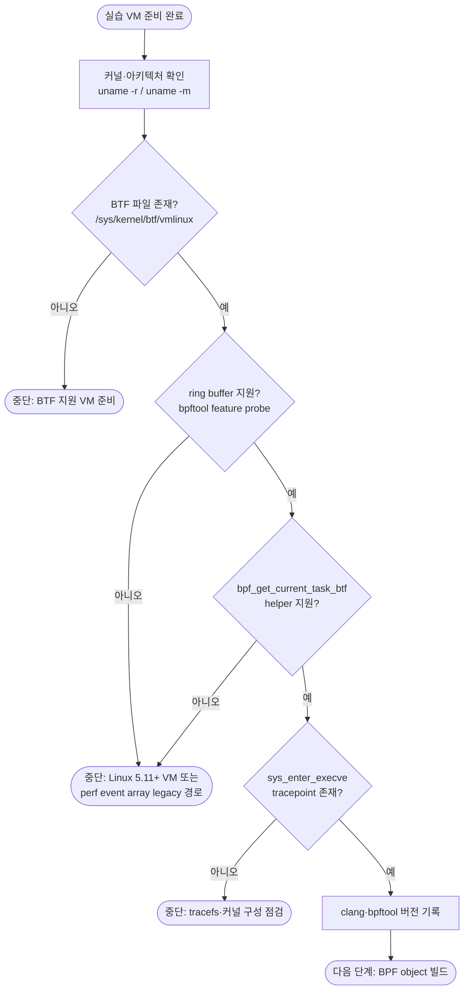

# 2026-10-25 — 실행 대상 적합성 확인

목표: 구성 완료한 실습 VM이 CO-RE와 ring buffer 기반 `execmon`을 실행할 수 있는지 확인한다.

## 성공 기준

- BTF, ring buffer, `bpf_get_current_task_btf()`, `sys_enter_execve`가 모두 확인된다.
- 실패 분기는 문제를 해결하기 전까지 다음 날짜로 진행하지 않는다.

