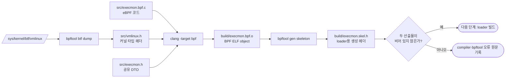

# 2026-10-26 — BPF object와 skeleton 생성

목표: 커널 타입 정보에서 `vmlinux.h`를 만들고, BPF object 및 loader용 skeleton을 생성한다.

## 핵심

`execmon.bpf.o`는 일반 실행 파일이 아니다. eBPF 명령과 map 정의가 든 ELF이고, `execmon.skel.h`는 loader가 이를 load·attach하도록 연결하는 생성 헤더다.

