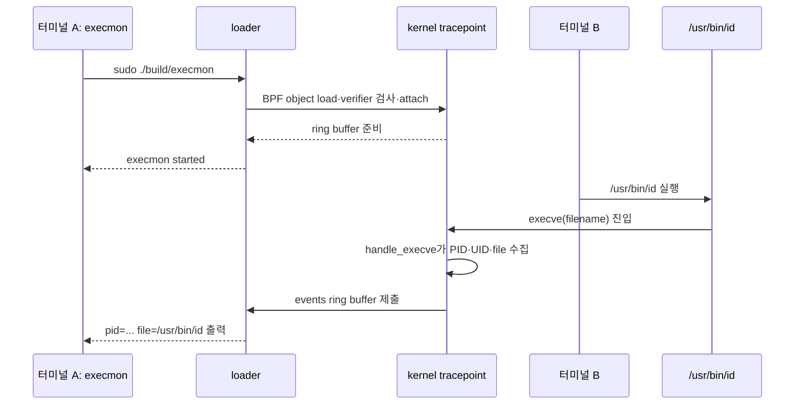

# 2026-10-27 — loader 최소 기능 테스트

목표: 실제 `execve` 요청이 커널 eBPF 프로그램에서 사용자 공간 출력까지 도달하는지 확인한다.

## 확인 포인트

- `file=/usr/bin/id`가 보이면 최소 데이터 흐름은 성공이다.
- `comm`은 `sys_enter_execve` 시점의 기존 task 이름이라 `bash` 또는 `sh`일 수 있다. 새 실행 파일명과 같지 않아도 정상이다.

